# Sim2Act · 从任务到证据的研究工作面

实际产品：`5f814c4831d84f5cdec0636c49740a6ad1c97429`，真实 Windows Server 2025 / 受保护 Edge；合成封存数据，零业务POST、零模型调用。下列是原生浏览器原图，不是设计稿或AI生成的截图。作者已亲看全部10张。

## 工作台：让任务、证据和结果成为一个连续工作面

改前：导航、标签和独立卡片堆叠。

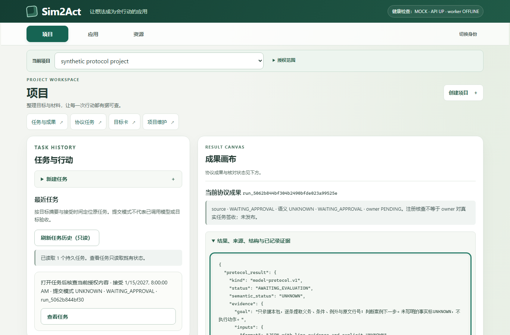

改后：稳定侧栏、辅助任务列、主要证据阅读面；工程预览身份、UNKNOWN、人工PENDING与未发布仍显示。

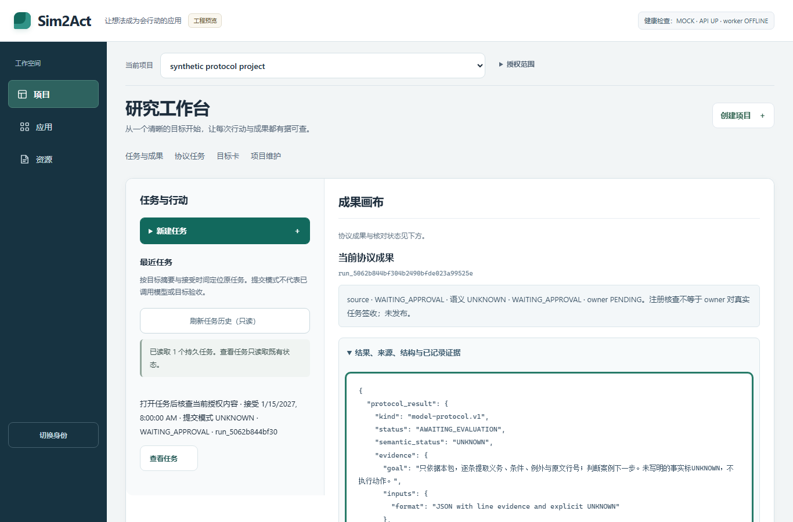

宽屏成果区顶部308.1px（第一轮406.7px失败原件保留），窄屏379.8px。没有提高原400/500px门。

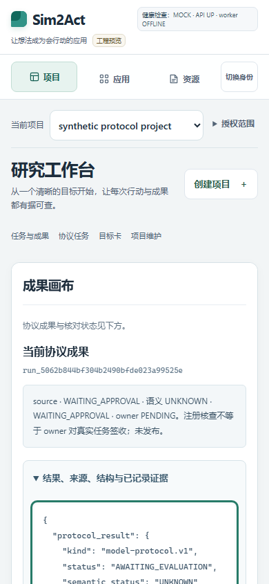

## 应用与资源：同一工作空间，不再复制一套卡片语言

应用页本次实际为空态，没有伪造已保存应用。

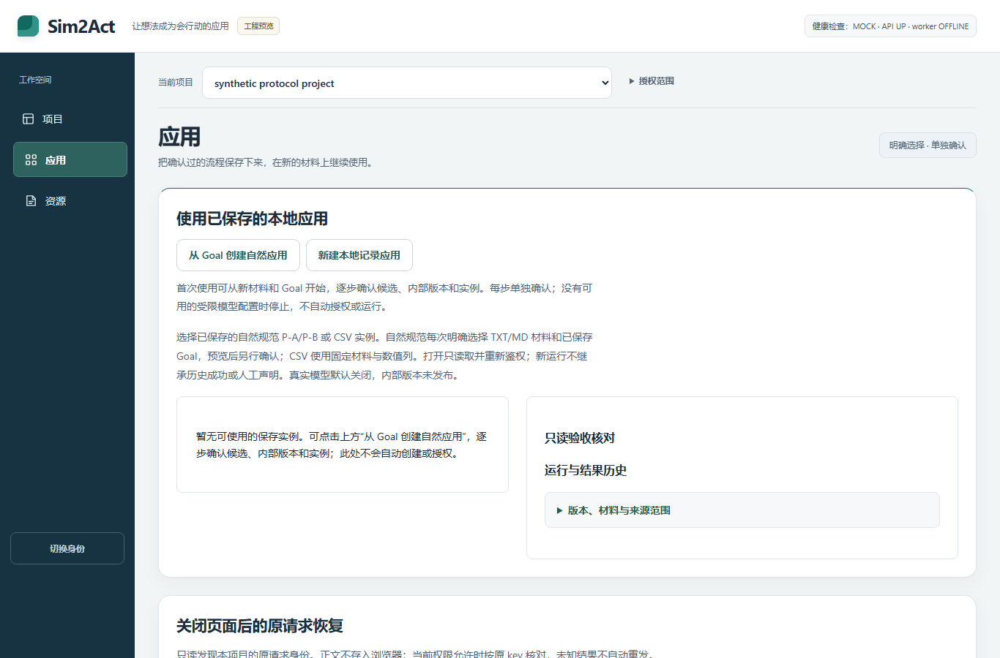

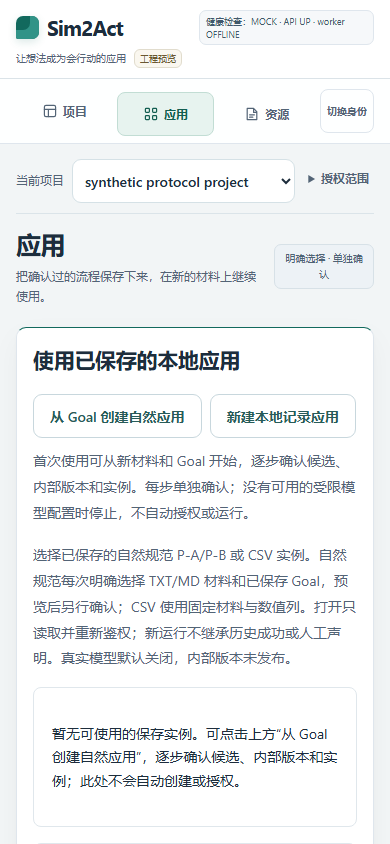

资源页是已授权合成材料的真实保存内容，全部长文本原样保留。

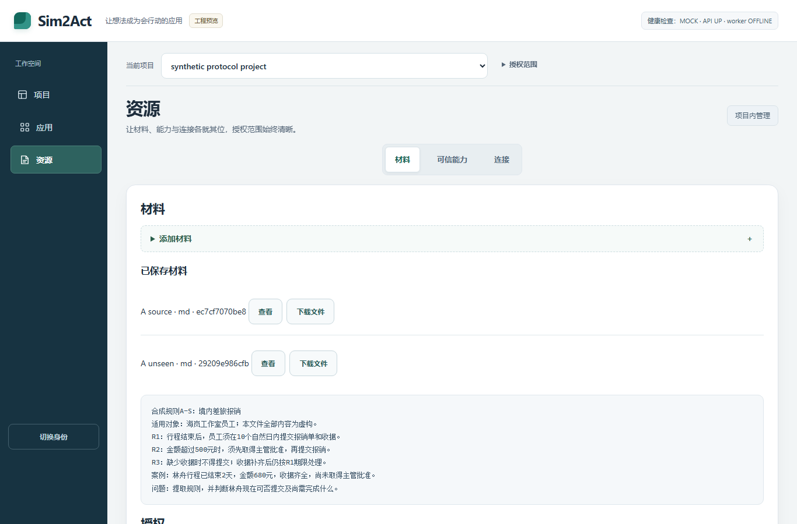

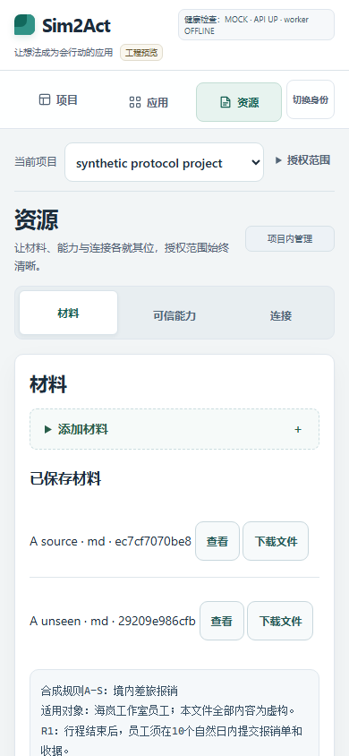

## 操作反馈和阅读

实际键盘展开创建表单、Tab进入名称，未提交。回执实际PageDown滚动193px，焦点可见。读取故障清除旧结果并关闭后续路径，真实Run状态没有改成假UNKNOWN。

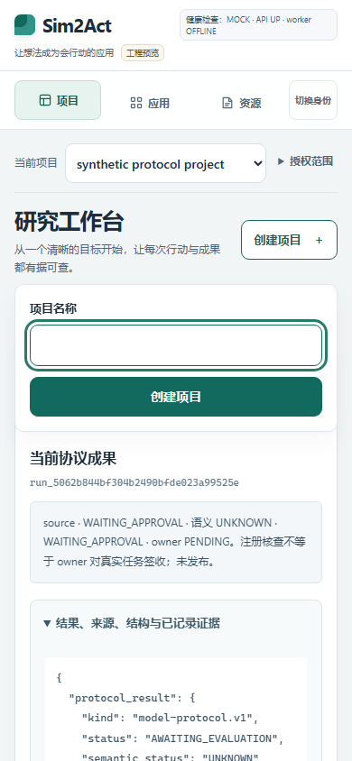

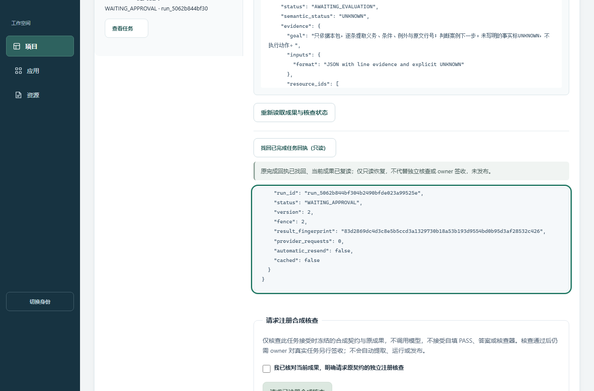

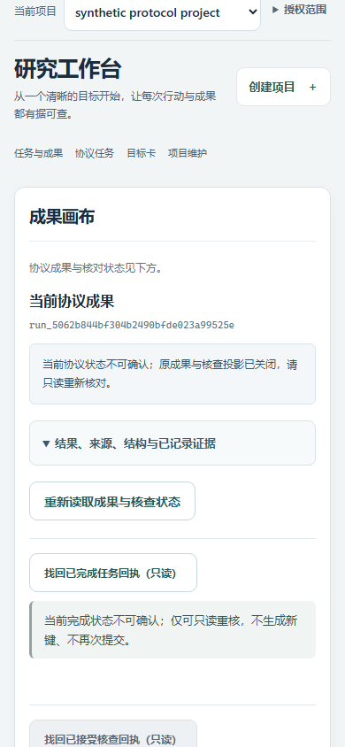

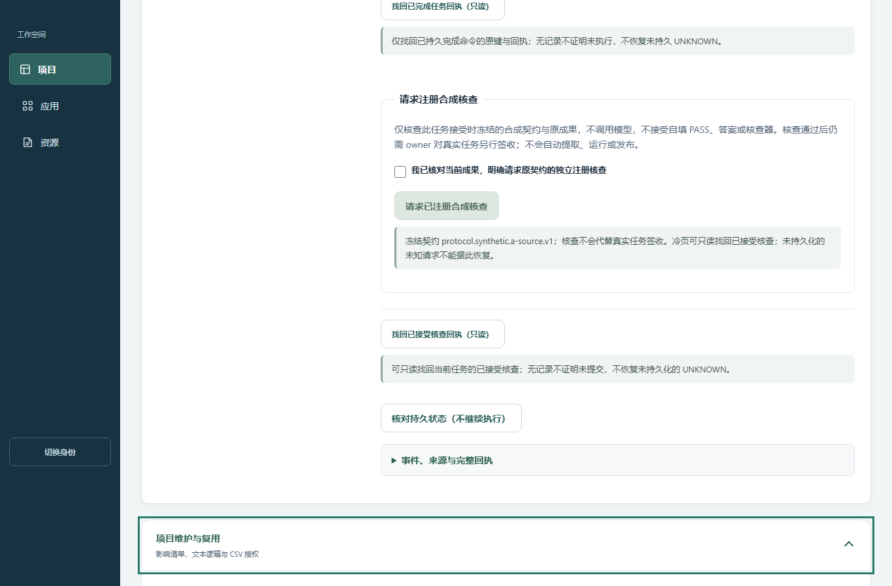

最后一张只拍到维护summary，不能说完整维护表单已拍；全部四工具的展开/收回由实际键盘与DOM检查覆盖。

## 已覆盖与边界

实际三工作区1366/390截图、320/768几何检查、原成果/材料/回执、焦点、表单展开、维护打开关闭、失败关闭和空项目引导均完成。49业务GET（服务端48，1次受控403在浏览器结束）、54静态GET、0POST；两封存库内容/sidecar及原期限保持不变，清理通过。

按钮保留约160ms颜色/边框反馈，高频操作没有位移/弹跳，减少动画关闭过渡；本轮是实际交互断言和静态帧，**没有视频、动效帧率或用户设备丝滑度测量**。加载态样式已实现，但此次截图均等稳定后采集，不能说加载态像素已验。Windows Server不是用户PC，也不是Android。整体审美仍待用户评判，不以测试绿灯自评“极致精美”。

[原始有界核查](https://github.com/T1doo/Sim2Act/actions/runs/39938146670/job/120362677543)
