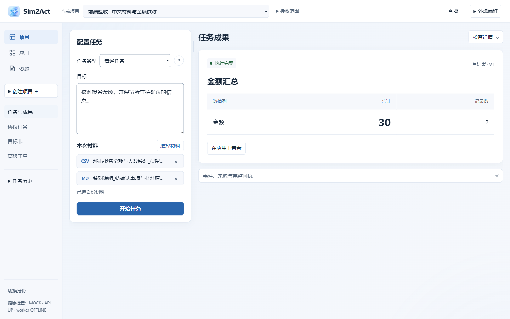
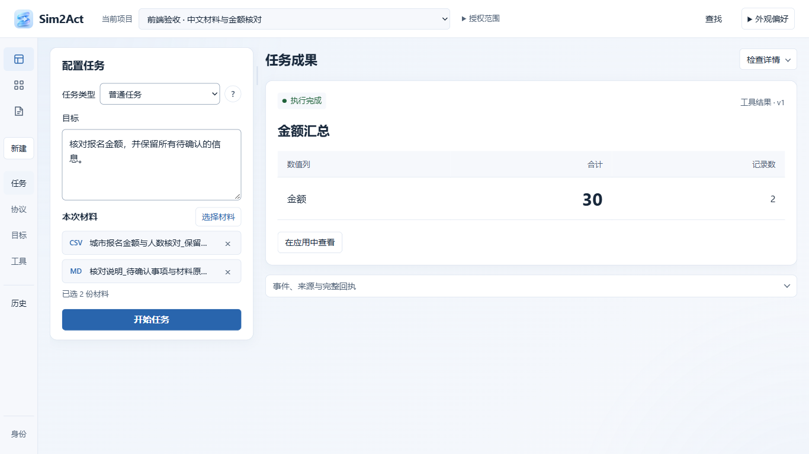
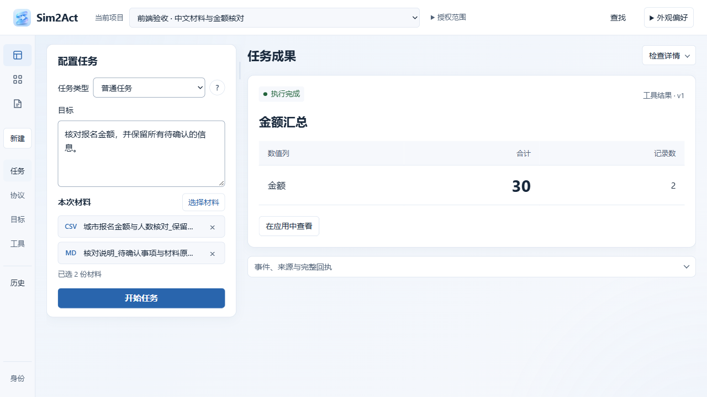
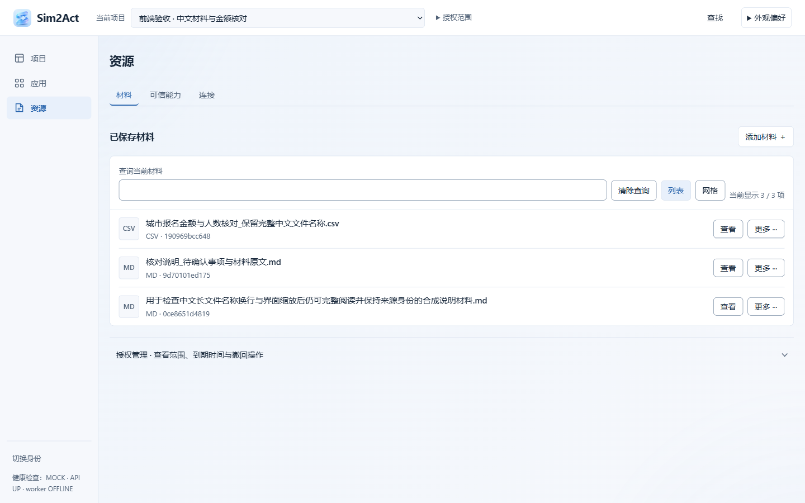
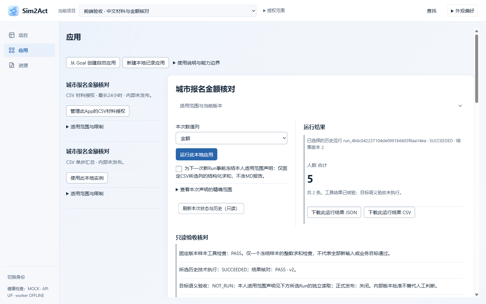
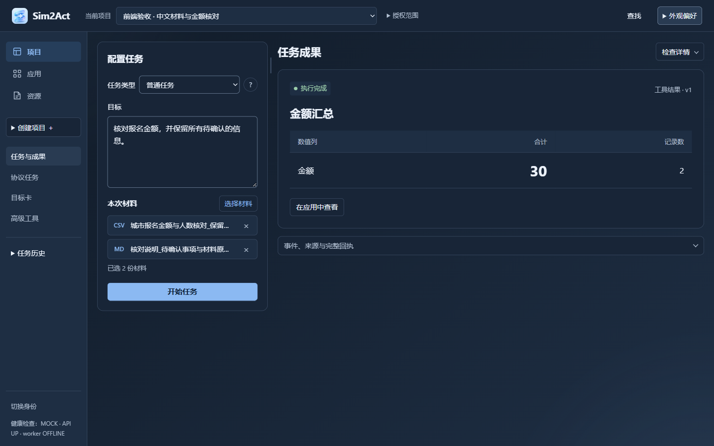
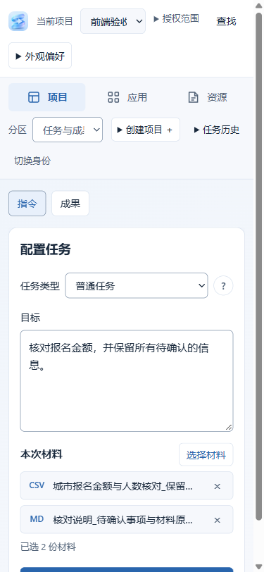
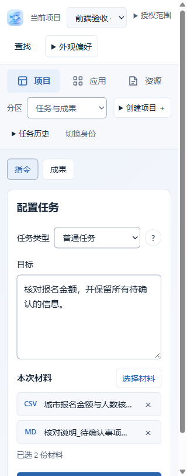
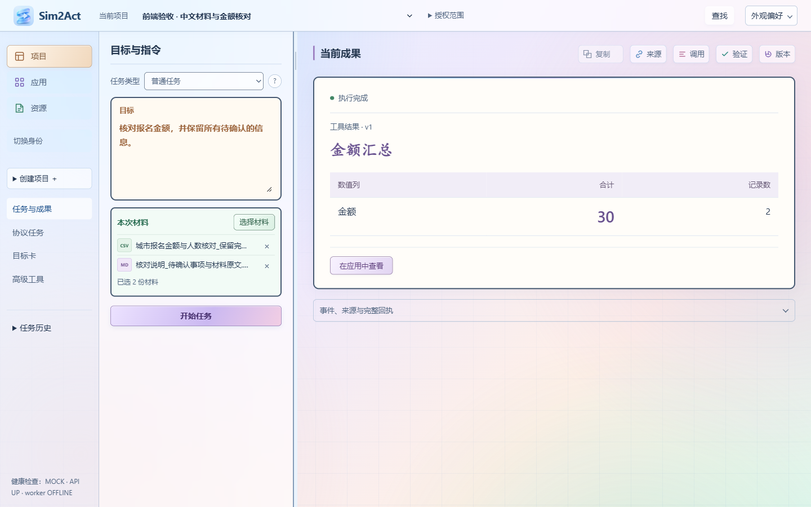

# Sim2Act 前端 UI/UX 审阅包

此入口整理当前浅蓝/白色专业工作台的截图、设计说明、源代码和可复制的GPT审阅提示词。截图来自Windows Chrome实际运行，使用独立合成测试库。

**审阅重点是当前版本。** 旧的多色、粗边框、重磨砂候选仅放在最后作历史对照，不应当作当前实现。图像与源码的SHA-256已经核对，记录见 [验证摘要](../../evidence/frontend-system-rework-20261104/verification-summary.json)。其中`uncommitted: true`是截图验收当时的历史状态，本审阅包与源码随后一同提交。

- [可复制的GPT审阅提示词](gpt-review-prompt.md)
- [项目内容与实现边界](../../../README.md)
- [统一UI规范](../../design/workbench-ui-system.md)
- [实际检查、截图与未验证范围](../../evidence/frontend-system-rework-20261104/README.md)

## 项目与本阶段说明

Sim2Act是一个把目标和授权材料转为可核查成果、并逐步沉淀为可重复运行应用的工作台。一级导航只有项目、应用、资源。项目内配置目标和材料、发起任务、阅读结果；应用内使用已有实例和历史结果；资源内管理材料、能力与连接。

前端是静态HTML/CSS与分模块JavaScript，由Python API提供，不是React/Tailwind项目。实际状态、权限、恢复键、版本与业务调用由原控制器负责。软件仍处于工程预览阶段，截图不是完整模型能力或正式产品验收证明。

本阶段清理了多轮重复样式覆盖，保留浅蓝、白、蓝灰色；配置区合为连续表单卡片，成果区获得更大空间；统一字号、间距、圆角、轻边框、阴影与交互状态；收起重复小字，将来源/调用/验证/版本集中到“检查详情”；弱化网格和装饰背景。已有功能、接口和真实状态保留。

截图中的金额30/v1与人数5/v2为真实保存的合成CSV计算结果。左侧目标输入是当前草稿，不应据此认定它已执行或修改了右侧既有成果。

## 01 当前项目工作台 · 1440×900

请重点看全局导航、任务配置和任务成果三大区域，以及“开始任务”和核心输出的视觉优先级。

## 02 常见笔记本窗口 · 1366×768

此尺寸使用窄导航；典型目标、两份材料和主操作可在配置区内完整显示。

## 03 较矮桌面窗口 · 1280×720

## 04 资源工作区

关注标题与添加操作、目录工具带、文件行、列表/网格切换、授权入口。

## 05 应用工作区

关注应用目录、当前输入、运行结果和验收/历史信息的主次。长页面含真实的验收与版本控制，不能简单删去以缩短页面。

## 06 深色模式

深色为已有可选模式；本轮主要审美方向仍是浅色。

## 07 小屏 · 375px

小屏采用正常纵向滚动和分区选择，不宣称全部内容一屏显示。截图用于检查可读性与重排，不等于手机实机验收。

## 08 小屏 · 320px

## 09 历史对照 · 不代表当前版本

这是系统性收敛之前的候选，仅供比较主次与信息密度。

## 代码入口

- [app.css](../../../src/sim2act/web/app.css)：先看`:root`，再看`Professional workbench system`部分，后者集中定义本轮视觉系统。
- [app.js](../../../src/sim2act/web/app.js)：重点看`frontendPresentation`、`renderInternalTaskResult`、`openMaterialPicker`、`openFrontendInspector`和`selectProjectSection`。
- [index.html](../../../src/sim2act/web/index.html)：原始页面及控件身份，部分节点在初始化时重组。
- [use.js](../../../src/sim2act/web/use.js)：应用输入、运行及历史结果。
- [internal.js](../../../src/sim2act/web/internal.js)：内部版本、实例、恢复、核查及高级流程。

## 请审阅者区分

静态截图可以支持布局、字体和信息层级判断；动效、焦点、等待/错误状态的结论需要结合代码或实际操作。209项回归与浏览器检查记录是功能证据，不能替代视觉判断。未进行独立的“三秒识别”用户研究；真实模型、正式PG和原生宿主等未验证范围以验收记录为准。
