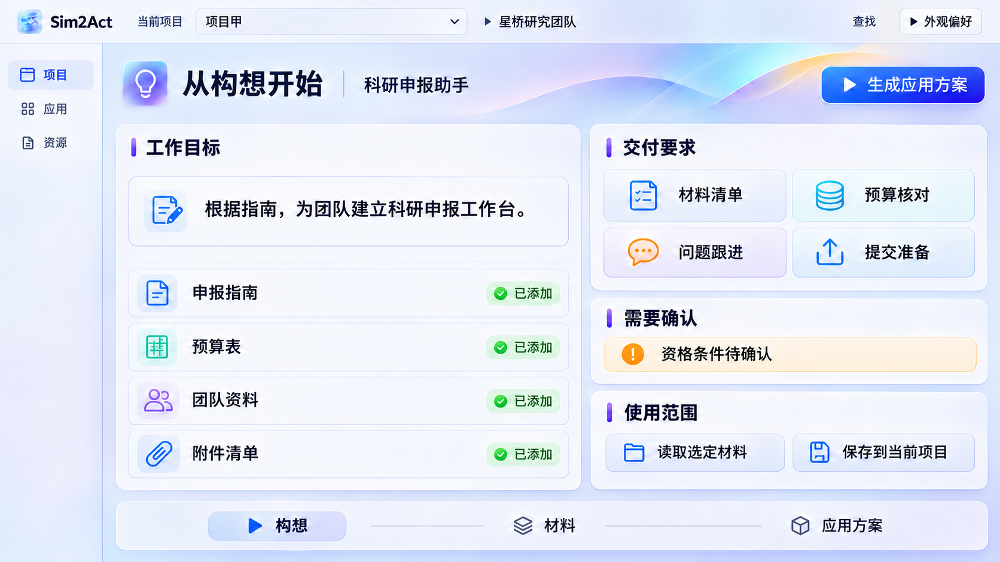
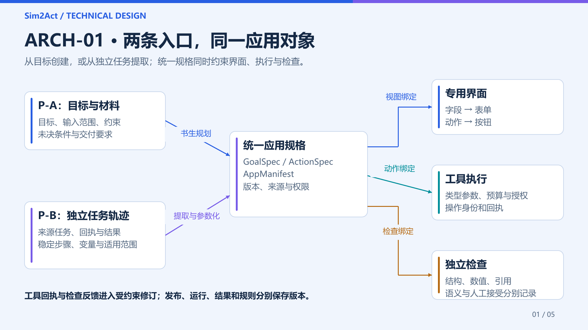
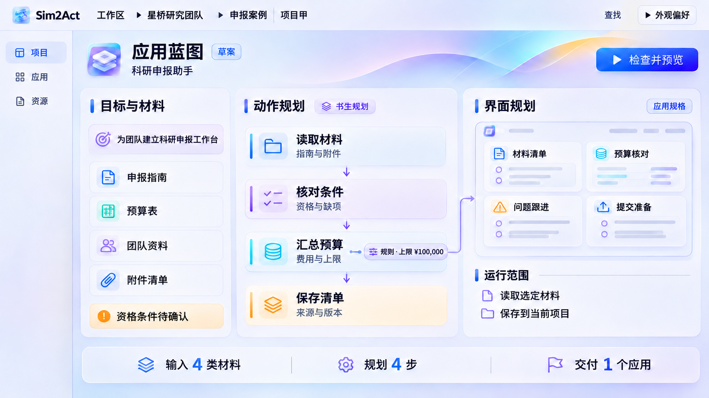
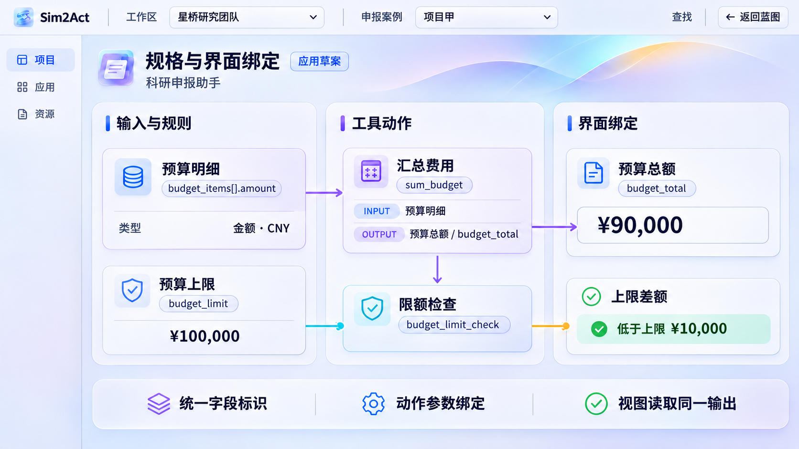
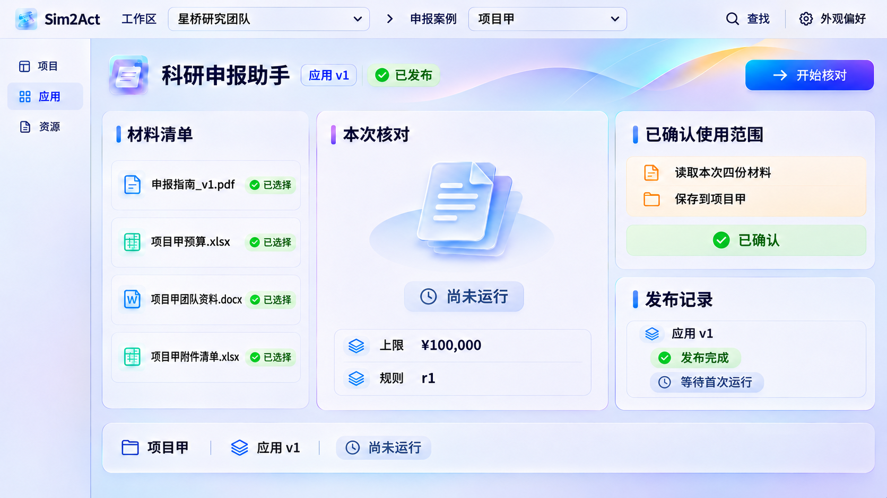
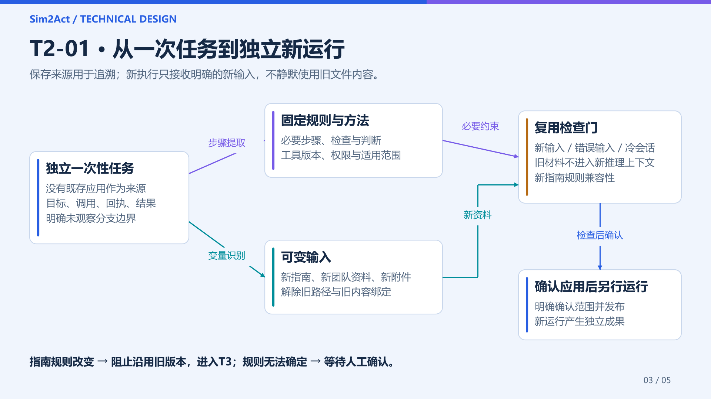
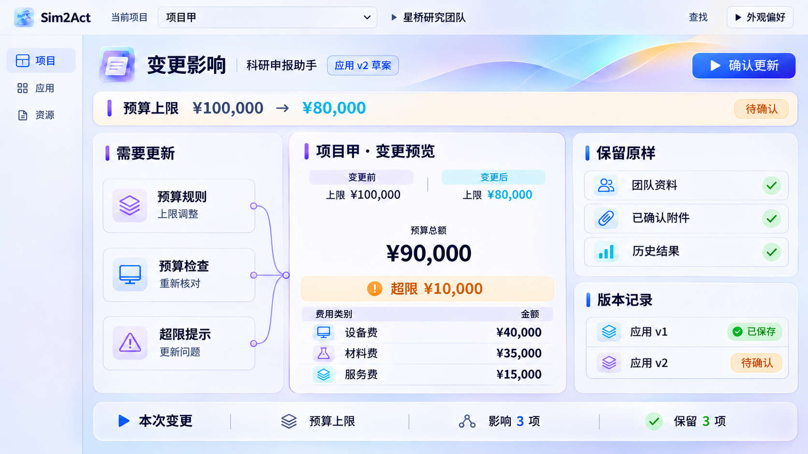
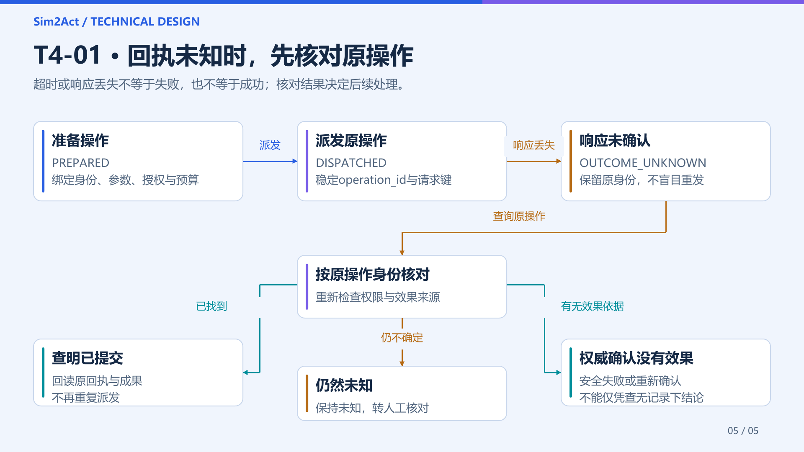
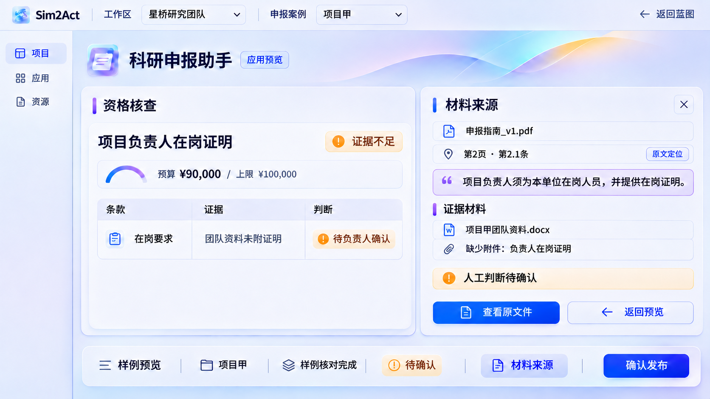
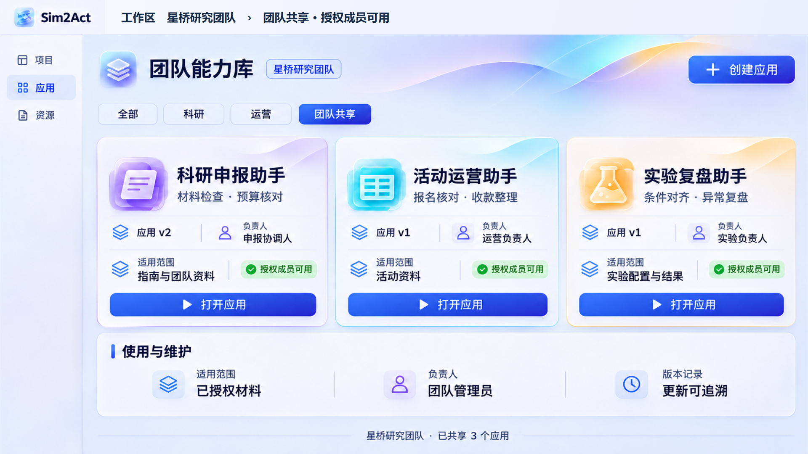

# Sim2Act：让构想成为可用的应用

正文介绍完整正式设计，工程附录记录实际运行版本与验证范围。仓库、下载链接与体验步骤见第15–16页；介绍视频链接待成片后补入。

## 第1页 · 让构想成为可用的应用

Sim2Act · 基于书生大模型的应用生成与演进平台

### 从申报协调人的工作开始

为科研团队的申报协调人，把指南、预算和附件核对方法组织成专用小应用。同事选择自己的材料即可使用；每次结果独立留存，规则变化沿着明确的依赖与版本维护。

### 从一次工作走向团队能力

同一套方法接收不同材料，产生独立结果；规则改变时，解释影响并更新相关模块。专业经验因此拥有明确的使用入口、责任边界与维护方式。

技术创新赛参赛产品书 · 审阅版 v01 · 2026.11.07

## 第2页 · 把专业方法留在应用里

面向科研团队、项目协作人员和运营负责人，将反复发生的材料型工作组织为可执行的软件。

### 待验证的工作假设

科研申报涉及指南、预算、团队资料与附件。我们提出的工作假设是：当核对规则散落在文件中、步骤依赖个人经验时，换材料和人员交接会产生重复配置与遗漏风险。该假设需要访谈和实际试用验证，不代表已有统计结论。

### 同事接手时，只换材料

应用明确输入、步骤、输出和待确认条件。同事不必重新描述整套方法，也不必编辑流程或JSON，只选择自己的资料并启动运行。首次构建与后续使用成本分别记录，避免只计算复用阶段的收益。

### 价值如何衡量

以首次构建成本、重复运行的人工配置量、缺项发现、修改返工及交接可理解性评价价值。产品页中的业务样例用于解释体验，用户收益和效率数字只采用实测结果。

科研申报主场景：目标、材料、交付要求与待确认条件集中呈现。

## 第3页 · Sim → 2 → Act

转换的产物是一套有界面、有动作、有运行约束的应用，而不是停留在会话里的执行建议。

### Sim：形成可确认的目标

目标与材料进入GoalSpec，显式记录输入范围、约束、交付要求和未决条件。无法从材料确定的事项保持待确认，成为后续规划的输入。

### 2：把意图转换为软件结构

P-A从目标与材料生成候选，P-B从独立任务提取稳定方法并解除旧文件绑定，两者汇入有版本的应用定义。书生负责理解、选择与修订；类型、权限、引用和数值检查约束候选。专用界面和工具参数由这份定义共同驱动。

### Act：使用、复用与演进

发布形成不可混淆的应用版本。每次运行绑定自己的输入和结果；已完成任务能够提取为应用；规则修改形成影响分析与更新计划。运行记录贯穿整个生命周期。

ARCH-01为总架构；T1至T4分别对应绑定、提取、演进和可追溯执行。两条入口汇入同一个有版本的应用定义。

## 第4页 · 先把需求说清楚，再生成应用

难点在于把开放语言落到可检查的结构，并让缺少的信息有明确去处。

### 可表达的应用结构

应用规格描述输入字段、注册工具、依赖步骤、输出路径、视图与检查。字段采用稳定标识；金额同时记录数值、币种和单位，不能只依靠“金额”标签猜测。开放语言先形成候选，再由独立检查约束。

### 一个可追查的拒绝与修订例

budget_items[].amount来自4、3.5、1.5万元。直接送入要求CNY的sum_budget会触发UNIT_MISMATCH。反馈定位到字段及单位；候选补充确定性单位换算，再输出budget_total:CNY=90000。权限和既定验收条件保持。

### 难点与验证

静态检查核对类型、引用与允许工具；运行检查核对当前授权、输入和输出。单位缺失不执行，规则不明等待确认。设计样例只说明机制，实际书生生成轨迹与验证范围见第13页。

| 对象标识 | 绑定约束 |
| --- | --- |
| budget_items[].amount | 输入明细，显式单位；不使用预算总额回填 |
| sum_budget | 仅接收已标准化的CNY金额 |
| budget_total / budget_limit | 分别为计算输出与独立规则输入 |

T1输出：可检查的应用规格，以及明确列出的未决条件。

## 第5页 · 规划负责选择，契约约束执行

书生连接目标与工具，运行器执行已确认动作，检查反馈推动方案修订。

### 候选、检查与执行分别记录

读取材料、选择动作、绑定参数后形成候选；规格检查返回字段位置和具体原因，书生受原目标与权限约束进行修订。蓝图表达计划，实际工具执行另留操作身份与回执，不能把预览勾选当作已执行。

### 模型深度参与的位置

书生承担需求解释、动作选择、参数映射和反馈修订；算术、格式与权限检查交给确定性组件。工具返回结构化结果或错误，模型不能用一段自然语言替代执行回执。

### 实现难点

相同工具在不同资源和授权下可做的事不同；失败可能来自资料不足、契约不符或外部服务。编排必须区分补输入、重新规划和终止，保留失败原因，并限制调用次数、用量与任务期限。

规划与执行分层：候选计划不替代真实回执；当前工程三次生成请求也不能被解释成三次错误修复。

## 第6页 · 同一份定义，连接按钮与结果

应用生成的核心是一致性：看见的字段、发出的参数、执行的动作与保存的结果应当指向同一对象。

### 字段、动作、视图同源

预算明细budget_items[].amount经单位标准化进入sum_budget，输出budget_total，同时绑定预算指标卡与budget_limit_check。预算上限budget_limit是独立规则输入。对照表单值、实际参数与制品字段，可检查是否发生错误绑定。

### 约束交互状态

缺少必填材料时阻止提交；运行期间呈现真实状态；失败保留可处理原因；未完成的人工确认不会被数值检查覆盖。更换材料产生新运行，避免将旧结果误当成本次输出。

### 验证重点

对同一输入比较表单值、动作参数和制品字段；对缺项、错误类型与越权输入检查阻断行为。以错误绑定数、不可达操作、结果归属错误和人工返工衡量生成质量。

T1-01补充单位拒绝与修订链；图中90000、100000与10000是统一设计样例，不是新执行记录。

## 第7页 · 应用可用之前，先确认它的边界

发布是从候选定义到可使用版本的明确动作，需要检查结果与用户确认共同支撑。

### 检查结论分层

结构与试运行检查回答应用定义是否可用，读写确认回答允许访问什么；业务资格与人工签收仍需独立判断。发布材料核查工具，并不表示负责人已具备申报资格，也不表示已对外提交。

### 先确认发布，再明确运行

用户核对材料、保存位置与手动启动范围，明确确认后发布。成功页显示应用v1已发布、尚未运行；再次点击开始核对后才进入本次执行。按钮启用、发布完成和任务成功是三个不同状态。

### 错误与恢复

缺附件、字段格式错误和撤销授权各有明确反馈。未知回执不通过重复点击另建任务来解决。旧成果与未决项保留，新输入产生自己的运行和结果。

S13—S14分别展示范围确认、发布完成、首次运行与结果，避免在镜头边界隐含跳过关键动作。

## 第8页 · 把做成的任务，提取为可复用应用

从一次执行中识别稳定方法，并解除旧文件、旧会话与临时判断的隐含依赖。

### 从独立任务提取

来源是一项尚未形成应用的一次性申报材料核查任务。沿已保存成果回溯必要调用，提取稳定步骤、来源定位及人工确认分支；将一次性文件绑定改为明确的输入参数，记录尚未观察的分支适用边界。

### 先检查新输入，再确认应用

新输入检查覆盖字段、类型、旧文件依赖、独立结果归属与规则兼容。范围检查通过后仍保留业务资格待确认；用户确认发布，再另行运行新材料，形成独立成果PB-01。来源任务记录继续用于追溯。

### 指南变化不能绕开演进

新指南先核对规则兼容性。若改变预算上限等固定规则，阻止沿用旧发布版本并进入T3；规则无法确定时等待人工确认。检查还应覆盖错误输入、冷会话，以及旧资料不再提供给新推理的情形。

T2-01：来源任务与P-A应用结果分离；影片的P-B链是正式设计展示，工程附录不据此增加实测通过项。

## 第9页 · 解释变化，也解释哪些保持不变

规则更新先形成影响范围，再形成新版本；应用定义与已有业务记录分别维护。

### 带来源的依赖与隔离预验

规则、字段、动作、视图和检查形成有类型依赖，记录边的定义来源及实际读取补充。从变更节点计算应变与应保持集合；未知依赖扩大核验，人工锁定冲突阻断覆盖。修改先在隔离预验中检查，不写入正式历史。

### 确认版本与启动运行分开

上限从100000元改为80000元，甲预算仍是90000元，预验超限10000元。团队资料、已确认附件及旧记录保留。用户确认后发布v2，再另行点击按新版运行；新结果编号3绑定应用v2和规则r2。

### 验证与难点

隐含依赖、派生字段和用户手动修改可能使影响图不完整。用预先标注的应变集与应保持集比较实际修改，记录漏改、误改、重验开销与回滚结果；不把“修改更少”自动视为正确。

T3-01：预验、冲突确认、发布及新运行分开；历史结果编号1继续绑定应用v1、规则r1。

## 第10页 · 让每次动作和结果都有归属

稳定输出依赖持久状态、明确的操作身份和可核对的回执，不能只看模型最后一句回答。

### 未知效果不能当作失败重放

操作先绑定身份、参数、授权与预算，再以稳定operation_id派发。超时或响应丢失进入OUTCOME_UNKNOWN。系统先核对原操作：找到已提交效果则回读原回执；权威确认无效果才安全失败或重新确认；仍不确定则保留未知。

### 本地与外部保障分别说明

本地受控写入可将业务效果和回执置于同一事务；外部动作取决于对方的请求身份、查询能力及一致性保证，不能承诺所有外部工具恰好执行一次。撤权与预算变化仍在动作边界复核。

### 每类检查各有职责

结构、数值、引用、语义与人工接受分别记录。项目记忆保存经确认的规则和依据；推测不自动成为事实。该页为机制设计，真实故障恢复效果须由相应测试支持。

T4-01补齐未知回执分支；不因查询返回空结果就推定远端没有效果。

## 第11页 · 科研申报，从构想到专用工作台

星桥研究团队的申报任务贯穿生成、使用、复用和规则更新，展示同一技术链如何服务真实工作。

### 专业判断落在条款与证据上

申报指南v1第2页第2.1条要求负责人为本单位在岗人员并提供证明。团队资料未附在岗证明，界面保持证据不足，负责人补充或确认；数值检查通过不会覆盖这项业务判断。材料存在性检查也不等于签字真实性核验。

### 甲乙是业务案例，结果独立

甲乙属于同一授权工作区内的申报案例，各有实例和运行；不是仅凭相同团队名跨安全项目读取。甲40000+35000+15000=90000元，乙30000+28000+18000=76000元。历史中的1/2/3是结果编号，应用与规则版本单列。

### 规则改变后维护既有工作

新指南上限80000元进入兼容核对与变更预验，确认后形成应用v2。预算数据保持90000元，新运行显示超限10000元；旧成果按原规则保存。提交准备只整理用户可检查的交付项，不自动对外申报。

业务样例为自编规范，PDF与文本定位单独留档；不代表真实申报政策或已跑通多格式业务。

## 第12页 · 同一种转换机制，多种专业应用

以专用界面承接领域任务，以统一规格、工具与检查支撑跨场景复用。

### 两个扩展场景的输入与输出

活动运营：报名、收款、退款 → 关联核对 → 差异清单与人工处理；设计样例的8000元是核对后的实收净额，600元退款另列，三项差异不与净额相加。实验复盘：两组配置与结果 → 条件对齐 → 差异及缺证据项；种子差异不能直接推出因果结论。

### 能力库与技能连接

能力库组织用途、负责人、适用输入、权限和版本。领域技能封装工具契约与检查规则；连接目录接入文件、表格、知识库及业务系统。MCP负责上下文与工具接入的协议边界，业务正确性仍由应用检查承担。

### 部署与维护责任

团队负责人确认用途、适用材料与共享范围；领域人员维护指南来源和人工判断分支；技术维护者管理运行环境、模型凭据、连接、版本与故障。先选择一项高频材料工作，分别记录构建、检查、培训与复用成本，再扩展场景。这是实施设计，不代表已完成组织部署。

组织落地采用领域能力包、团队协作空间与机构部署；价值通过访谈和试用验证。

## 第13页 · 书生生成与两份材料复用记录

冻结提交21b33dc4的内部工程记录：两份90、94字节短文本，同一实例、同一限定应用版本，分别保存结果修订1与2。

| 类型 | 原材料引用 | 新材料引用 |
| --- | --- | --- |
| 要求 | Submit the report by Friday. | Send the form by Monday. |
| 例外 | An approved delay is allowed. | A reviewer may grant an extension. |
| 未决项 | The archive owner is undecided. | The retention period is undecided. |

### 记录链与生成过程

候选包含read → model_all → verify → save步骤。三次生成请求间记录材料读取回执、规格检查与最终候选验证；不能仅按调用次数称为三次错误修复。生成终态PARTIAL，后续保存内部工程版本；两次实例执行状态为SUCCEEDED。

### 用量与时间可随包追算

五次用量依次为2672、6514、6127、1016、1007 tokens，合计17336。两次执行从ACCEPTED到终态STATE分别为203.8986822秒、249.8111992秒，包含排队、等待和工具检查，不是纯模型延迟或性能基准。

### 验证范围保持明确

六条原文引用逐字匹配；两次来源核验PASS，语义验收NOT_RUN、人工签收PENDING。内部命名空间及正式发布门的原值保留。该记录不证明中文四类文件申报、P-B实际提取、原生窗口生命周期或完整R0通过。

| 随包文件 | 可独立核对内容 |
| --- | --- |
| 冻结记录_脱敏字段.json | 请求身份、事件时间、回执与结果归属 |
| 逐次模型用量.csv | 3次生成 + 两次执行的逐次计数与用量 |
| verify_evidence.py | 离线重算用量/耗时、引用、同实例与候选指纹 |

证据目录：submission/05_代码与模型/工程证据_21b33dc4_v02。完整供应商响应正文未附，离线检查不等于供应商侧独立证明或业务重跑。

## 第14页 · 用可检验的机制证明创新

创新主张聚焦目标、工具、专用界面、独立检查与版本维护的贯通，并用明确任务评价这一组合。

### 已有方法与本作比较对象

Dify已有模型、工具、分支和人工审核；Lovable支持自然语言构建全栈应用。AWM研究经验中的可复用工作方法，LangGraph提供持久化基础，Skyframe提供依赖增量计算。因此不把工具调用、轨迹提取或持久化单独称为首次。[R3–R7]

### 控制条件与观察量

固定模型、工具、输入、预算及人工介入，比较绑定错误、完成情况、复用总成本、漏改/误改与未知效果处理。首次构建和核验成本必须计入复用比较；保留原始样本数与失败。ChatDify作为近邻预印本参考，不移用其成功率为本作结论。[R8]

### 已测与拟测分别报告

已测记录仅为第13页限定工程切片。中文多格式任务、单位错误的真实模型修订、P-B去旧依赖、锁定冲突和外部未知效果等对照尚待执行，不能由正式设计图补成通过。

| 比较对象 | 已有能力 | 本作拟检验重点 |
| --- | --- | --- |
| Dify / Lovable | 编排或全栈应用生成 | 规格、界面、动作与检查一致性 |
| AWM | 从经验诱导复用流程 | 参数化应用、权限和新输入独立性 |
| LangGraph | 检查点与跨运行存储 | 操作效果、版本归属、未知回执 |
| Skyframe | 依赖与增量计算 | 语义不确定、动态读取和人工锁定 |

评分：实用性40%、完整性30%、技术实现难度30%。比较方案与已测结果分别列示，不给出未经同条件测试的优胜结论。

## 第15页 · Windows部署架构与体验路径

公开仓库提供源码与说明，Release提供Windows开发预发布包。下列为拟体验路径与依赖说明；包体可下载、EXE已构建，不等于全新Windows首次配置、窗口生命周期与完整业务流程已经验收。

### 1. 下载并打开

通过第16页的Release页面或安装包直链下载Windows x64压缩包，完整解压到独立目录，双击Sim2Act/Sim2Act.exe。EXE已构建完成，不需要自行编译；不要只复制单个可执行文件。

### 2. 环境与首次设置

需要Windows x64、.NET Framework 4.6.2或更新版本，以及Microsoft WebView2 Runtime。包内已含私有Python和PostgreSQL运行文件。首次启动按应用提示选择数据目录及连接配置；真实模型使用自己的API凭据。

### 3. 建议体验顺序

进入项目与资源区域，添加示例材料，再查看任务目标、应用入口和运行历史。真实执行能力以当前配置及软件反馈为准。发布包不含本机项目数据或共享模型密钥；首次使用、原生窗口与完整业务流程仍需验收。

### 4. 版本与复现

当前公开版本为v0.1.0-dev.20261107.1，构建源码为21b33dc4。Release附发布清单和SHA-256校验文件，固定源码可由第16页链接查看。书生托管API的历史记录模型别名为intern-s2；它不等于固定权重快照。

体验形态为Windows桌面软件下载，不是在线网页演示。当前公开包是开发预发布；下载入口可访问不等于所有业务功能已经验收。

## 第16页 · 项目入口、软件下载与提交信息

Sim2Act，让构想成为可用的应用。复旦大学 · 旦愿人长久团队。

### 公开体验入口

项目仓库提供源码与说明，Release页面提供Windows开发预发布包。下方链接均可在PDF中点击；安装包直链指向同一已发布版本，约72.5MiB。

### 提交材料状态

影片固定4分30秒，视频网盘链接待正式成片后补入。关键代码和模型说明仍按赛事要求独立打包；当前GitHub源码与开发版是可访问入口，不代替完整产品验收。

| 项目 | 当前信息 |
| --- | --- |
| 作品品牌 | Sim2Act · 让构想成为可用的应用 |
| 参赛单位 / 团队 | 复旦大学 / 旦愿人长久 |
| Windows版本 | v0.1.0-dev.20261107.1 · x64开发预发布 |
| 构建提交 | 21b33dc4e8d6f0dfb74c65e9cf91cd5af31ed9ce |
| 介绍视频 | 270秒制作中；网盘链接待成片后补入 |

- [项目仓库 · https://github.com/T1doo/Sim2Act](https://github.com/T1doo/Sim2Act)
- [Release页面 · https://github.com/T1doo/Sim2Act/releases/tag/v0.1.0-dev.20261107.1](https://github.com/T1doo/Sim2Act/releases/tag/v0.1.0-dev.20261107.1)
- [Windows应用包直链（ZIP，约72.5MiB）](https://github.com/T1doo/Sim2Act/releases/download/v0.1.0-dev.20261107.1/Sim2Act-Windows-x64-v0.1.0-dev.20261107.1.zip)
- [固定源码 · 21b33dc4](https://github.com/T1doo/Sim2Act/tree/21b33dc4e8d6f0dfb74c65e9cf91cd5af31ed9ce)
- [下载校验 · SHA256SUMS.txt](https://github.com/T1doo/Sim2Act/releases/download/v0.1.0-dev.20261107.1/SHA256SUMS.txt)
- [R1 · 书生系列项目参考](https://github.com/InternLM/Intern-S1)
- [R2 · MCP架构说明](https://modelcontextprotocol.io/docs/2026-07-28/learn/architecture)
- [R3 · LangGraph持久化说明](https://docs.langchain.com/oss/python/langgraph/persistence)
- [R4 · Dify Workflow Studio](https://www.dify.ai/workflows)
- [R5 · Lovable官方介绍](https://docs.lovable.dev/introduction/welcome)
- [R6 · Agent Workflow Memory（ICML 2025）](https://proceedings.mlr.press/v267/wang25bx.html)
- [R7 · Bazel Skyframe](https://bazel.build/reference/skyframe)
- [R8 · ChatDify预印本（2026-11-01）](https://arxiv.org/abs/2611.01563)

公开链接已无凭据核对；二维码指向同一Release页面。正式视频链接待成片，真实功能与小样验收按各自记录处理。
